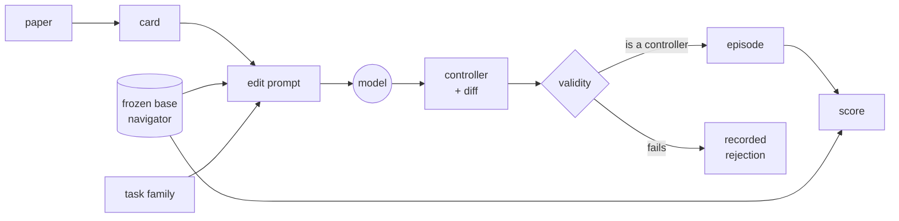
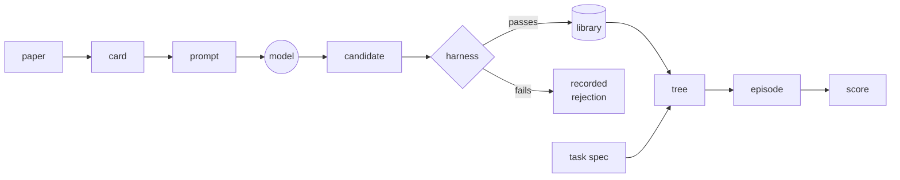
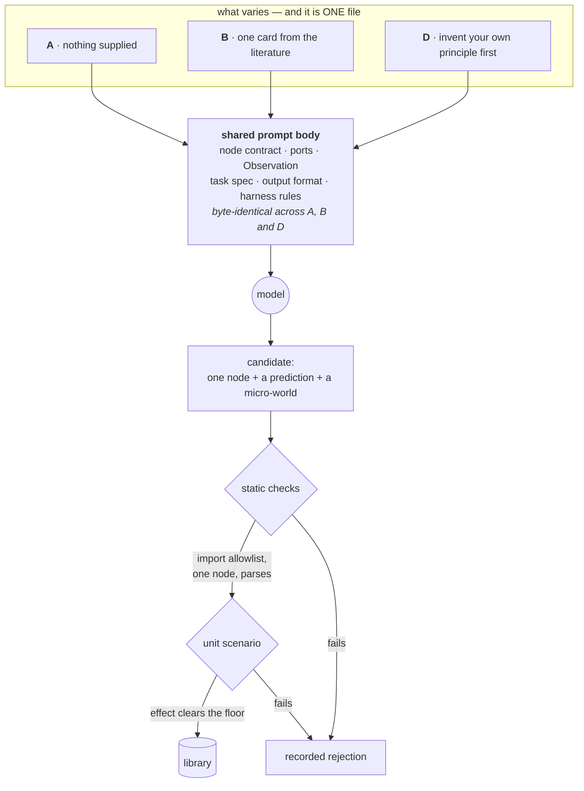
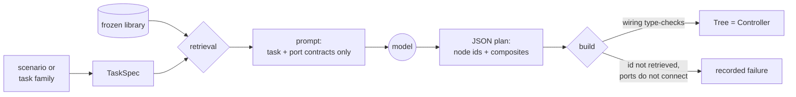

# The pipeline, and the words we use for it

A map of the vocabulary and how the pieces connect. `CLAUDE.md` is the operating
manual and the source of truth for decisions; this file is the thing to read
first if the words *card*, *node*, *port* and *admission* are not yet a single
picture in your head.

> ⚠️ **THE SPINE CHANGED ON 2026-09-21. THE BEHAVIOUR TREE IS GONE.**
> A card no longer becomes a *node* that joins a *library* and is *composed* into a *tree*. A
> card is now fed, with the frozen base navigator's source, to a single **edit** call that
> returns **a whole `core.observation.Controller` and a diff**. See
> `plans/07-epic-whole-controller.md`.
>
> **The vocabulary that survives:** paper, card, arm, candidate, admission, episode, score.
> **The vocabulary that is now historical:** node, port, `WRITES`, `Layer`, arbitration,
> retrieval, composition, tree. Those sections are kept and are accurate for the library that
> still sits in `nodes/` and `generate/staging/` — they are just not the live path.

---

## The one-sentence version

⚠️ **Current, from 2026-09-21.** We extract **principles** from research papers into
**cards**, hand an arm's cards — together with the source of one frozen, already-scored
**base navigator** — to a model, and get back **a whole controller and a diff**. An automatic
check decides only whether the artefact *is* a controller; whether it is a *better* one is
settled by scoring it against the same base on the same worlds. Then we measure whether the
controllers written with literature navigate better than the ones written without it — which is
what the control arm **`p`** is for.

⚠️ **Historical, to 2026-09-21.** We extracted principles into cards, handed one card at a
time to a model, got back one **node** — a small typed piece of robot behaviour — let an
automatic **harness** decide whether that node worked, kept the ones that did in a **library**,
and composed them into **trees**.

Nothing is trained. The robot's walking is inherited and frozen. The only thing
that varies is the *code above the legs*, and where that code's ideas came from.

---

## The spine

**Current, from 2026-09-21:**

Read left to right: **a paper becomes a card; a card plus the base becomes a whole
controller; the controller drives a robot; and the robot's number is compared against the
same base on the same worlds.** ⚠️ The base appears twice on purpose — it is both the input to
every edit and the reference every score is paired against.

⚠️ **Arm `p` is the same picture with the card node removed.** That is the whole of the
control: no card, everything else identical.

**Historical, to 2026-09-21:**

Read left to right: **a paper became a card, a card became a node, nodes became
a tree, a tree drove a robot, and the robot got a number.**

Each arrow is a place something can be checked, and most of the project's design
effort went into making those checks automatic rather than a matter of judgement.

---

## The objects, in order

### Card

**One principle, extracted from one source.** A YAML file in `cards/`, one card
per file, named after its id. Six fields:

| Field | What it holds | What it becomes |
|---|---|---|
| **Source** | citation, plus a *span* — the page, section or equation | node metadata |
| **Mechanism** | what the finding says happens | the node body |
| **Trigger** | when it applies | the precondition |
| **Derivation** | how the finding becomes a rule for *this* robot | the node body |
| **Prediction** | the falsifiable claim | the unit test |
| **Confidence** | HIGH / MEDIUM / LOW extraction confidence | node metadata |

Two things about cards are less obvious than the list suggests.

**The Prediction is structured, not prose.** It carries a `metric`, a `baseline`,
a `min_effect` and a `cost_metric`. That is what makes "the Prediction becomes
the unit test" mechanical rather than aspirational — a card whose Prediction
names nothing measurable is rejected when the card store loads, not discovered
later. `cost_metric` is the honest half: what this mechanism makes *worse*. A
card that cannot say what it costs is a card that will be reported selectively.

**Verification is a separate state from Confidence.** Confidence is how sure the
extractor is; *verified* means a human has opened the paper and checked the span.
An unverified card is never counted as traceable, however plausible its citation
looks. Right now **0 of 5 cards are verified**, so the provenance number the
project reports is 0.0 — see `cards/VERIFICATION.md`. This is deliberate: a span
written from memory is exactly the confabulation the whole provenance argument
exists to detect.

The card is also the **interface**. Nothing downstream knows what a paper is.
Swap the extraction step for a different corpus, a different field, a human
typing them by hand — the rest of the pipeline does not change. That is what
"source-agnostic" means here.

---

### Node

**One leaf of a behaviour tree.** A small class with one precondition, one
effect, and a typed interface. Three kinds, and the kind is a real distinction
rather than a label:

| Kind | Does | May emit a Twist? |
|---|---|---|
| **Condition** | answers one question about the world | no |
| **Action** | does one thing | **yes — only kind that may** |
| **Decorator** | wraps exactly one child and governs it | no |

Each node declares `PORTS`, `PRECONDITION`, `EFFECT`, `TAGS`, and carries
metadata saying where it came from. Examples from the description:
`IsLocalisationDegraded` (Condition), `LimitSpeedToVisibleRange` (Action),
`RateLimitedRetry` (Decorator).

**One precondition and one effect** is not a style rule. A unit scenario has to
isolate one claimed effect; it cannot isolate two. A node that needs two of
either is two nodes.

**No coupling to a specific scenario** is enforced, not requested. A node is
handed a restricted view of the ports it declared and nothing else, and a
generated node is refused if it imports anything that could show it the map.

---

### Port

**How nodes pass information to each other.** Typed, directional, and drawn from
a **closed vocabulary of seven**:

`POSE` · `BEARING` · `SPEED` · `RANGES` · `CONFIDENCE` · `FLAG` · `REGION`

Ports are deliberately *not* a blackboard. A blackboard is easier to generate
against and much harder to check — any node can read anything, and "no coupling"
stops being enforceable. Instead each node gets a `PortView` restricted to the
ports it declared, and touching anything else raises immediately.

The vocabulary is closed because composition retrieves nodes *by port*: "what
produces a Bearing?" is only a useful question while the answer is a handful of
nodes rather than one. Adding an eighth type is a planned chunk of work, not an
edit.

---

### Twist

**`(vx, vy, wz)` — the frozen interface, and the only thing anything ever sends
the robot.** Below it sits the inherited, pretrained, never-retrained locomotion
policy. Above it is the entire experiment.

A Twist is **not a port**. Ports describe information flowing between nodes; the
Twist is the actuation channel leaving the system. An Action emits one with
`ports.drive(command)`; a Condition or Decorator that tries to raises.

---

### Tree

**Nodes composed into something that can drive a robot.** Two composites —
`Sequence` ("and then") and `Fallback` ("or else") — plus a `Tree` that *is* a
Controller, so a composed tree drops into the episode runner with no changes to
the runner at all.

**Wiring is checked when the tree is built, not when it ticks.** A tree whose
ports do not connect is rejected at construction. Catching it mid-episode would
mean a bad wiring scores a timeout and looks like a bad *idea*.

---

### Library

**The append-only store of admitted nodes.** Nothing is ever removed, edited or
compressed away; retrieval is what keeps the working set small at composition
time, not deletion.

That is not tidiness. One of the project's goals counts distinct admissible
primitives, and a library you can delete from is one whose count depends on when
you looked. `snapshot()` hashes the library's contents into a tag that goes into
every run's manifest, so every reported number names the exact library it came
from.

---

### Unit scenario

**The admission test: does this node actually do what it claims, alone?**

A node is admissible only if it passes one. Pass or fail is decided
automatically, with no human in the loop. The harness enforces three things the
generator cannot talk its way around:

1. There is a **fixed baseline**, named, run over the same world.
2. **The baseline must actually fail.** A scenario whose baseline already
   succeeds is rejected as *malformed*, not passed — it is testing nothing.
3. **The effect must clear a floor fixed in advance** (half a rate point for
   goal-reaching, 10% relative otherwise). A scenario may demand more of itself.
   It may never demand less.

Requirement 2 is the important one. It is the check that catches *"I wrote a test
that was already true."*

---

### Micro-world

**The purpose-built little room a unit scenario runs in.** A few boxes, a start,
a goal, a seed. Measured by the *same* geometry code the real benchmark uses —
not a second implementation — because otherwise passing a unit scenario would
say nothing about the benchmark.

**Stated limitation:** a micro-world is rolled out *kinematically* — a point
robot that turns and translates exactly as commanded, with the locomotion policy
absent entirely. **A node that passes here may still fail under physics.**
Admission is a necessary condition, never a sufficient one.

---

### Scenario

**A real benchmark task** in the lab42 room: a start, a goal, a time limit, and
whether the goal is disclosed and whether the pose estimate drifts. Two sets:

- the **dev set** (3 scenarios) — seen during generation, used freely;
- the **held-out set** (12 scenarios) — **sealed**, never seen during
  generation, used once at the end to measure whether the library generalises by
  recombination alone.

The seal is half mechanical (nothing on the generation path may import the
held-out file, checked by walking the syntax tree) and half procedural (the
sessions that generate must never have read it). The procedural half is the part
no test can enforce, which is why it is written down in three places.

---

### Observation

**Everything a controller is allowed to see**, one per control step: a 181-beam
scan, a *believed* pose, a localisation-error estimate, a contact flag, and the
goal — *or `None`, meaning the goal has not been found yet.*

**Ground truth never enters an Observation.** The runner knows the true pose and
the true goal the whole time and uses them only for scoring. That is what makes
localisation failure measurable and search a real task rather than navigation
with extra steps.

---

## The generation path, and the four conditions

This is where the experiment actually lives.

The **four conditions** all use the identical frozen locomotion policy, the
identical seed set and the identical episode count:

| | Condition | Gets |
|---|---|---|
| **A** | Naive LLM | the node contract, no literature |
| **B** | Literature-informed | the node contract **+ one card** |
| **C** | Human baseline | an off-the-shelf tuned Nav2 stack (not generated) |
| **D** | Invented principles | the node contract, told to devise its own principle |

What each comparison is for:

- **B − A** — does the literature step earn its place at all?
- **B − C** — the headline: does any of this beat a competent human stack?
- **B − D** — **the one that matters most.** It separates genuine information
  gain from the model restating what it already knew. A and B and D are all the
  same model; if B only beats A because articulating *any* principle helps, D
  will show that.

⚠️ **Known wrinkle, not yet re-decided.** D is asked to articulate a principle
and A is not — that is what makes D a different condition rather than a
rewording of A. The consequence is that **B − A confounds the corpus with the act
of articulating a principle, and only B − D isolates the corpus.** Consistent
with ranking B − D highest; inconsistent with an earlier claim that B − A is
clean. Owned by the pre-registration chunk.

**The prompts are the independent variable**, so they are three real files that
differ *only* inside a delimited literature block — asserted by a test that
strips the block and diffs what is left. If they ever drift apart anywhere else,
the experiment measures that drift instead of the corpus.

---

### Candidate → admitted node

A **candidate** is a staged, un-judged node: the model's output, written to disk
with its provenance, deciding nothing yet. **Admission** is the automatic verdict.

Between them sit the static checks, and the load-bearing one is the **import
allowlist**: a candidate may import `math`, `numpy`, and three project modules —
nothing else. One rule buys three properties. It makes "no coupling to a specific
scenario" mechanical (the candidate cannot reach the scenario definitions), it
keeps ground truth out (it cannot reach the geometry that knows where the walls
are and would otherwise pass its test brilliantly by cheating), and it extends
the held-out seal to code that did not exist when the seal was checked.

**A rejection is an outcome, not an error.** Every rejected candidate is kept
with its reason, because the pass rate is a reported number and a rate needs a
denominator — and because a rejected node is the most informative thing the
pipeline produces.

---

### Provenance: origin vs traceable

Two different facts, deliberately kept apart:

- **Origin** — where the node came from: `CARD`, `INVENTED`, or `HANDWRITTEN`.
  Required on every node. Conditions A and D legitimately produce nodes with no
  source, so "no source" has to be a *value* rather than an omission — otherwise
  you cannot tell *invented* from *nobody wrote it down*.
- **Traceable** — origin is CARD **and** there is a source span **and** somebody
  verified it. This is the fraction actually reported.

A node from an unverified card is `CARD` and **not traceable**. Today that is
every card node, which is why the provenance figure is 0.0 and honest.

---

## The composition path

Generation writes leaves. **Composition arranges them**, and it is a separate
step with a hard rule: **it sees only port contracts and a task specification.
Never the papers.** If composition could read a card's Mechanism it would be
doing generation again, and "solved by recombination alone" would not be a
distinct claim.

### TaskSpec

**What composition is told about the task, and nothing else.** Two bits carry
almost all of it: `goal_known` (is the goal disclosed at t=0 — does the tree
need an exploration branch?) and `pose_drifts` (does the pose estimate degrade?).
Those are exactly the axes of the sealed held-out split, so composition sees the
*shape* of each held-out family without ever seeing a held-out scenario. Add the
sensor configuration and the twist limits, and that is the whole spec.

Deliberately absent: the id, the start, the goal, the seed — and the **time
limit**, which was proposed and then measured: within three of the four held-out
families it is the only field that differs between the three scenarios, so a
spec carrying it could tell an episode from its family.

### Retrieval

The library is append-only, so by evaluation time it will not fit in one prompt.
Retrieval keeps the working set small. Two mechanisms, and only one is ranking:

- **Port closure is the hard one.** An action reading `goal_known: Flag` needs a
  producer of `goal_known: Flag` in the same set or the tree cannot be wired at
  all. Ranking alone would routinely hand the model a set from which no legal
  tree exists.
- **Tag and text overlap is the soft one**, and it is weak — node tags are
  model-chosen at generation, so a node tagged `("dwa", "braking")` overlaps
  nothing a task spec says.

**Every retrieval is logged**: what was considered, what each scored, why each
retained node was retained, what was dropped, which ports nothing could satisfy,
and which outputs nothing reads. That last one matters: "the library had the
right node but retrieval never surfaced it" and "the library lacked the node" are
completely different failures, and the outcome cannot tell them apart.

### Plan

**Composition returns a JSON tree over node ids. It never returns Python.** This
is the decision the whole step turns on. G3 claims held-out scenarios were solved
by recombination alone, **no new primitives** — and if composition emitted code,
that would be a rule the model was asked to respect. A plan whose entire
vocabulary is a list of retrieved ids makes it structural: there is no channel
through which a new primitive can arrive.

The same decision makes the **repair loop** rewire-only for free. A composition
that fails can be re-prompted with the failure signature, and it is handed the
*previous* retrieval — the same vocabulary — so it cannot create even if it
wanted to. The log records `kind` and `repair_of` to keep the two separable.

⚠️ **A composition that succeeds is not a composition that works.** Two committed
records, same library and same retrieval: one reaches the goal, the other puts a
driving action ahead of another inside a Sequence — where RUNNING
short-circuits — and starves it. Nothing in a port contract says how often a
precondition fires, and that is what decides which of the two you get. See
`compose/FINDINGS.md`.

---

### Transcript

**The record of one model call**, filed under a hash of the exact prompt text.
Holds the full prompt, the full response, the model id and the sampling settings.

This is how the project gets reproducibility, and it is worth knowing *why* it is
done this way: `temperature` was removed from the API on current models, so
"temperature 0, therefore identical output" is not available to anyone. Replaying
a committed transcript rebuilds a candidate byte-for-byte with no model, no key
and no network — a stronger property than temperature 0 would have given.

The distinction to keep straight: generation is **reproducible** (you can rebuild
exactly what happened) but **not repeatable** (running the same prompt again may
give something different). Both matter and they are not the same word.

---

## What gets measured

Every episode is scored automatically. **Goal-reach rate is primary**; also
recorded are path efficiency, collisions and near-misses, stuck events and
recovery time, and time to goal.

The three goals:

- **G1 — a traceable primitive library.** ≥20 admissible nodes, each passing its
  unit scenario. Reported: node count, unit pass rate, and the fraction carrying
  a verified source span. The count is taken *per condition* — that is the
  coverage measure, and it stands whether or not any performance difference
  shows up.
- **G2 — the four-condition ablation**, with the decision rule written down
  *before the first run*. ⚠️ The threshold, the seed set and the episode count
  are still open and are owned by the pre-registration chunk.
- **G3 — compositional generalisation.** Freeze the library, then measure what
  fraction of the sealed held-out scenarios can be solved by **recombination
  alone, no new primitives** — for the literature-informed library and the naive
  one both.

One metric is deliberately excluded from performance reporting:
`localisation_failures` cannot be moved by any controller (drift is injected
open-loop, so it is identical across controllers that behave nothing alike). It
is kept as a **manipulation check** — did drift actually bite? — and reporting it
as performance would let "condition B localises better" be read out of a number
that cannot show it.

---

## Where things actually stand

Built and tested: the scored reproducible episode, the sim-free core, the node
contract, the library, the unit harness, the promotion gate, five hand-curated
cards, the sealed split, the generator, and composition. **414 tests, no
simulator, ~100 s.**

Not yet: the batch runner, the pre-registration, and the evaluation itself.
**The library currently holds one admitted node**, against the twenty the first
goal asks for — four model calls is a pilot of the pipeline, not its output, and
the compositions demonstrated so far lean on handwritten fixture leaves that can
never be a benchmark condition.

Cautions worth carrying forward, documented at length in `generate/FINDINGS.md`
and `compose/FINDINGS.md`:

1. **The harness cannot detect card infidelity.** A deliberately vague card was
   *admitted*: handed a contentless mechanism, the model invented a real one and
   the invented mechanism passed on its own merits. The harness tests whether the
   **node** works, not whether it implements the **card**. B − D is the control
   that absorbs this, but it has to be stated rather than assumed.
2. **A cleared effect floor is not evidence of generalisation.** The generator
   designs its own micro-world, so it can build one adversarial to the baseline.
3. **A composition that builds is not a composition that works**, and no
   composed tree has run in the simulator yet — every composition number so far
   comes from the idealised kinematic rollout, which is not a benchmark path.
4. **The one admitted node has two effects**, which the node contract forbids and
   neither the harness nor composition can detect: it publishes a speed *and*
   drives. The unit scenario tested the speed and passed.
5. **Every reported number must come from the pinned container**, against named
   scene assets and a named library snapshot. The local machine is for authoring.
